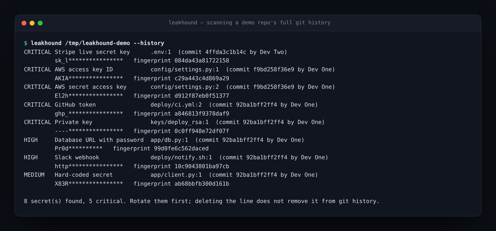

# leakhound

    

Find leaked credentials (cloud keys, tokens, private keys, database passwords) in a codebase **and in its git history**, where a "deleted" secret still lives. It runs as a CLI, a pre-commit hook, or a CI step that reports to GitHub's Security tab.

```
$ leakhound demo-repo --history
CRITICAL AWS access key ID           deploy.sh:1  (commit 662464c54f43 by Dev)
         AKIA****************   fingerprint 27638949126fb580
CRITICAL GitHub token                notify.py:1  (commit 183475b07ed0 by Dev One)
         ghp_****************   fingerprint 82a1d7374209dc18
HIGH     Database URL with password  settings.py:3  (commit 662464c54f43 by Dev)
         j37H**************   fingerprint 3225bb13847446d0
MEDIUM   Hard-coded secret           settings.py:2  (commit 662464c54f43 by Dev)
         pLIi****************   fingerprint ade319c48ed849b0

4 secret(s) found, 2 critical. Rotate them first; deleting the line does not remove it from git history.
```

The GitHub token above was removed in a later commit, so a normal scan of the working tree is clean. `--history` still finds it, along with the commit and author that introduced it.

## Screenshots

These come from `python examples/make_demo_repo.py`, which builds a throwaway git repo with planted fake credentials. One of them was committed and then deleted, which `--history` still catches.



**HTML report (`--format html`):** a self-contained dashboard. Secrets are always redacted, so the report is safe to share.


## What it detects

| Kind | Rules |
|---|---|
| Provider keys (exact formats) | AWS access key ID and secret, GitHub classic and fine-grained tokens, GitLab, Slack tokens and webhooks, Stripe live keys, Google API keys, OpenAI keys |
| Key material | PEM / OpenSSH / PGP private keys |
| Tokens | JWTs |
| Connection strings | `postgres://`, `mysql://`, `mongodb+srv://`, `redis://`, `amqp://` with an inline password |
| Generic | `password` / `secret` / `api_key` / `token` assignments, kept only if the value has high **Shannon entropy** |

How it keeps noise down:

- Generic matches need entropy ≥ 3.5 bits/char, so `password = "Summer2026"` in a test is ignored while a random 24-character string is not.
- Placeholders are skipped: `changeme`, `<your-key>`, `${ENV_VAR}`, `{{ template }}`, `os.environ[...]`.
- A more specific rule wins: a GitHub token in `github_token = "..."` is one finding, not two.
- Binary files, lockfiles, `node_modules`, virtualenvs and build output are skipped.
- Secrets are **redacted** in all output unless you pass `--show-secrets`.

## Usage

```bash
pip install .
leakhound                               # scan the current directory
leakhound path/to/repo --history        # every commit on every branch
leakhound --format sarif -o out.sarif   # for GitHub code scanning
leakhound --format json                 # for a SIEM or a script
leakhound --history --format html -o report.html   # self-contained HTML dashboard (values redacted)
```

Exit code `1` when anything is found, so it fails a build.

**Suppressing known findings**

- Add `leakhound:ignore` to a line, or list paths/globs in `.leakhoundignore`.
- For an existing repo with old findings you've already rotated: `leakhound --baseline .leakhound-baseline.json --update-baseline` once, then run with `--baseline` so only new leaks fail CI. Baselines store fingerprints (a hash), never the secrets.

**Pre-commit hook** (blocks the commit before the secret ever lands):

```yaml
# .pre-commit-config.yaml
repos:
  - repo: https://github.com/Sparsh-khanal75/leakhound
    rev: v1.0.0
    hooks:
      - id: leakhound
```

**GitHub Actions**: see [`.github/workflows/ci.yml`](.github/workflows/ci.yml), where leakhound scans its own history and uploads SARIF so findings appear under *Security → Code scanning*.

## If it finds something

1. **Rotate the credential first.** Removing it from the code does nothing for a key that is already in history or in a clone.
2. Check the provider's logs (CloudTrail, GitHub audit log) for use since the commit date.
3. Then remove it from history (`git filter-repo`) if the repo is public, and move the value to a secret manager or environment variable.

## Tests

```bash
pytest -q
```

23 tests, including real git repos built in a temp directory to check history and staged-change scanning. Test secrets are assembled at runtime, so this repo passes its own scan.

## License

MIT
